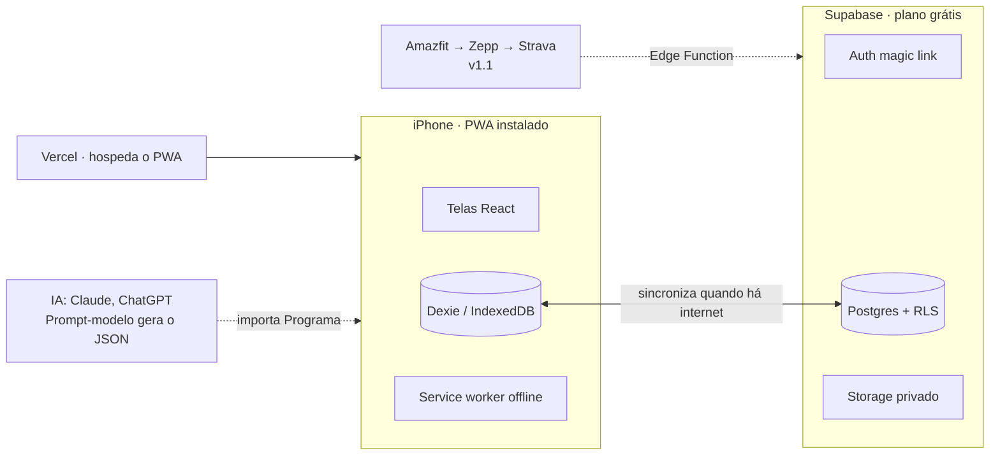

# PRD — App de Treino *(nome provisório)*

> Versão editável e comentável: o doc no Claude (link no frontmatter). Este arquivo é a cópia versionada no repositório; ao mudar o PRD, atualize os dois.

## 0. Propósito do documento

Este PRD define o que o MVP do app de treino precisa fazer em 7 dias e o que fica para depois. Ele segue a estrutura do template de PRD do BMAD Method (visão, jornadas UJ, glossário, features com FRs numerados, escopo, métricas, premissas), para que depois possa entrar direto no fluxo `bmad-prd` → `bmad-ux` → `bmad-architecture` → `bmad-build` dentro do repositório do projeto.

Os termos do Glossário (§3) são usados de forma exata no resto do documento. Premissas não confirmadas aparecem marcadas como `[PREMISSA]` e estão listadas no §10.

## 1. Visão

Um app que junta, num só calendário, musculação, corrida, yoga e qualquer outra modalidade, e que sempre sabe qual é o próximo treino. O registro de séries continua tão bom quanto o do Hevy (peso e reps por série). A diferença está em três pontos: o treino vem de fora e entra pronto, a agenda anda sozinha e a experiência tem o cuidado de UI do Runna.

O treino personalizado é gerado em qualquer IA (Claude, ChatGPT etc.) a partir de prompts-modelo fornecidos pelo app, e importado como arquivo. A dieta segue a mesma lógica: um plano vindo da nutricionista ou de uma IA, transformado em cardápio, receitas e lista de mercado, sem contador de macros.

Para pessoas trans em hormonização, o app guarda exames e mostra a evolução de força e composição ao longo da linha do tempo da hormonização, gerando um resumo para levar ao endocrinologista. Começa como ferramenta pessoal do Ingrid e é desenhado desde o início para ser aberto a outras pessoas.

## 2. Usuário-alvo

Persona principal (v1): o próprio Ingrid. Treina de 5 a 6 vezes por semana: 4 dias de musculação, 2 de corrida e 1 de hot yoga. Usa relógio Amazfit, foca em força e performance e faz hormonização com testosterona.

Público futuro: pessoas que misturam musculação com outras modalidades e querem o treino montado por IA, com atenção especial a pessoas trans em hormonização.

### 2.1 Jobs to be done

- Abrir o app e saber na hora qual é o treino de hoje, sem ter que olhar o histórico.
- Registrar séries, peso e reps durante o treino com o mínimo de toques.
- Trazer um treino gerado por IA para o app sem precisar montar exercício por exercício. Desejável: integração com a IA onde a sessão do chat já cria o output dos treinos no app.
- Ver musculação, corrida e yoga no mesmo calendário semanal.
- Seguir o plano alimentar sem contar macros e já sair com a lista de mercado semanal.
- Enxergar a evolução de força, peso, medidas e fotos junto com a linha do tempo da hormonização.
- Chegar na consulta do endocrinologista com um resumo pronto.

### 2.2 Não-usuários (v1)

- Personal trainers montando treinos para vários alunos.
- Quem quer contar calorias e macros com banco de alimentos.
- Usuários Android (o PWA funciona, mas o MVP é testado só no iPhone).

### 2.3 Jornadas principais

- **UJ-1. Ingrid abre o app de manhã e já vê o treino do dia.** A tela Hoje mostra "Treino B — Costas e bíceps", porque o último registrado foi o A. Ele toca em Começar.
- **UJ-2. Ingrid registra a musculação no meio da série.** Para cada exercício, vê o peso e as reps da última vez, ajusta, marca a série como feita e o descanso começa a contar. No fim, salva e o próximo treino da rotação avança sozinho.
- **UJ-3. Ingrid importa um treino novo gerado por IA.** Copia um prompt-modelo do app, cola na IA com seu objetivo e histórico e recebe um arquivo. Ao importar, o app mostra uma prévia (dias, exercícios, séries), aponta exercícios que não reconheceu e ele confirma. A rotação nova substitui a antiga a partir de hoje.
- **UJ-4. Ingrid registra a corrida e o hot yoga.** A corrida chega do relógio via Strava (ou é registrada à mão: distância, tempo, pace). O yoga é registrado em dois toques (modalidade e duração). Os dois aparecem no calendário ao lado da musculação.
- **UJ-5. Ingrid organiza a semana de comida.** Importa o plano da nutricionista ou da IA, vê o cardápio do dia com as receitas e gera a lista de mercado da semana agrupada por seção.
- **UJ-6. Ingrid prepara a consulta com o endocrinologista.** Registra peso e medidas, sobe fotos de progresso e o PDF do último exame. Na tela Evolução, vê força e composição numa linha do tempo com os marcos da hormonização e exporta um resumo em PDF.
- **UJ-7 (v2). Ingrid compartilha um treino com a comunidade.** Ao concluir a Sessão, vê Duração, Volume e um recorde novo, toca em Compartilhar e publica no Feed. Amigos que o seguem curtem e comentam; nenhum dado de hormonização aparece.

## 3. Glossário

| Termo | Definição |
| --- | --- |
| Sessão | Um treino realizado numa data, de qualquer Modalidade. Tem início, fim, Duração e notas. |
| Duração | Tempo entre o início e o fim de uma Sessão, calculado pelos horários registrados. |
| Volume | Soma de peso × reps das Séries feitas numa Sessão (kg), acompanhada do total de reps. |
| Modalidade | Tipo de Sessão: musculação, corrida, ciclismo, yoga ou outra. Define quais campos são registrados. |
| Exercício | Movimento do catálogo (ex.: supino reto). Pertence a um grupo muscular e tem equipamento. |
| Série | Registro de um Exercício dentro de uma Sessão: peso (kg), reps, RPE opcional e status feita/pulada. |
| Template | Treino planejado (ex.: "Treino A"): lista ordenada de Exercícios com séries e reps-alvo. |
| Rotação | Sequência ordenada de Templates (ex.: A → B → C → D) que define o Próximo treino. Pode incluir dias de cardio. |
| Próximo treino | O primeiro treino da Rotação ainda não feito nem pulado, pela ordem da Agenda. |
| Dias de treino | Dias da semana em que a pessoa treina e quantos treinos cabem em cada um (ex.: sábado com 2). |
| Agenda | Distribuição dos próximos treinos da Rotação, em ordem, nos Dias de treino. Mostra o que está planejado na semana. |
| Programa | Pacote importado de uma IA: Rotação + Templates + metadados (objetivo, nível, semanas). |
| Prompt-modelo | Texto pronto do app que a pessoa cola numa IA para gerar um Programa ou Plano alimentar no formato importável. |
| Plano alimentar | Cardápio por dia/refeição com Receitas e calorias por refeição, importado da nutricionista ou de uma IA. Sem macros. |
| Receita | Ingredientes com quantidade + modo de preparo + kcal da porção. Alimenta a Lista de mercado. |
| Lista de mercado | Soma semanal dos ingredientes das Receitas, agrupada por seção do mercado. |
| Registro corporal | Peso, medidas (cintura, peito, braço, coxa etc.) e Fotos de progresso numa data. |
| Exame | Resultado laboratorial guardado como PDF/imagem, com data e marcadores digitados opcionalmente. |
| Marco hormonal | Evento na linha do tempo da hormonização: início, mudança de dose ou de via. |
| Resumo para consulta | PDF gerado com evolução de força, Registros corporais, Exames e Marcos hormonais de um período. |
| Post (v2) | Sessão publicada por escolha da pessoa, com Duração, Volume, recordes, foto e texto opcionais. |
| Feed (v2) | Lista de Posts dos perfis que a pessoa segue, do mais recente ao mais antigo. |

## 4. Features

Sete features. As marcadas **MVP** entram nos 7 dias; as marcadas **v1.1** vêm logo depois; **v2** é a Comunidade.

### 4.1 Hoje e Rotação automática — MVP

Resolve a maior dor com o Hevy: lembrar qual foi o último treino. Realiza UJ-1.

- **FR-1.** O app calcula o Próximo treino como o primeiro treino da Rotação ativa ainda não feito nem pulado. Um Dia de treino que passa sem Sessão não pula nada: o treino segue esperando. *Teste:* registrar o Treino A faz a tela Hoje mostrar o Treino B.
- **FR-2.** A pessoa pode pular qualquer treino planejado: ele sai da fila e o sucessor ocupa o lugar dele, como se nada tivesse sido pulado. Também pode trocar o treino do dia por qualquer Template; um Template fora da Rotação não mexe na fila. *Teste:* com A na segunda e B na terça, pular o A põe o B na segunda.
- **FR-3.** A tela Hoje mostra também a semana (seg–dom) com as Sessões feitas e as planejadas, de todas as Modalidades.
- **FR-4.** Não há limite de Templates nem de Rotações.
- **FR-34.** A pessoa escolhe os Dias de treino da Rotação e quantos treinos fazer em cada dia. A Agenda distribui os treinos na ordem da Rotação nesses dias. *Teste:* Rotação A–F com seg, ter, qui e sex mostra A, B, C e D nesses dias.
- **FR-35.** A pessoa pode mudar o dia de um ou mais treinos da Agenda. Só o treino movido muda: o dia de origem fica livre e os outros continuam onde estavam; nada se repete na semana seguinte. *Teste:* mover o C de quinta para sábado deixa seg A, ter B, sex D, sáb C, e a semana seguinte começa no E.

### 4.2 Registro de musculação — MVP

Mantém o que funciona no Hevy. Realiza UJ-2.

- **FR-5.** Para cada Exercício, a pessoa registra Séries com peso e reps, pré-preenchidos com os valores da última Sessão daquele Exercício.
- **FR-6.** Marcar uma Série como feita inicia um timer de descanso configurável por Exercício.
- **FR-7.** A pessoa pode adicionar, remover e reordenar Exercícios e Séries durante a Sessão sem alterar o Template.
- **FR-8.** A Sessão em andamento sobrevive a fechar o app, ficar sem internet ou bloquear a tela (salvamento local contínuo).
- **FR-9.** Ao concluir, o app destaca recordes pessoais (maior peso e maior 1RM estimado por Exercício). O 1RM estimado usa a fórmula de Epley: peso × (1 + reps ÷ 30).
- **FR-25.** Durante a Sessão, um cronômetro mostra a Duração desde o início, visível no topo da tela e mantido mesmo com o app em segundo plano (calculado pelo horário de início, não por timer rodando). *Teste:* bloquear a tela por 10 min e voltar mostra a Duração correta.
- **FR-26.** Durante e ao fim da Sessão, o app mostra o Volume: peso total acumulado (soma de peso × reps das Séries feitas, em kg) e total de repetições. Séries puladas não contam. *Teste:* 3 Séries de 10 × 50 kg = 1.500 kg e 30 reps.
- **FR-27.** O resumo da Sessão concluída mostra Duração, Volume, total de reps, número de Séries e recordes; a tela Evolução mostra o Volume por semana e por grupo muscular.

### 4.3 Importação de Programa por IA — MVP

O jeito principal de montar treino. Realiza UJ-3.

- **FR-10.** O app oferece Prompts-modelo por objetivo (força, hipertrofia, performance de corrida) que pedem a resposta num formato JSON definido pelo app.
- **FR-11.** A pessoa importa um Programa colando o texto ou enviando o arquivo `.json`/`.md`. O app valida o formato e mostra uma prévia antes de salvar.
- **FR-12.** Exercícios do Programa que não batem com o catálogo são sinalizados, e a pessoa escolhe entre mapear para um existente ou criar um novo.
- **FR-13.** Um Programa importado vira a Rotação ativa a partir da data escolhida. A Rotação anterior fica arquivada.
- **FR-14.** O app inclui alguns Programas prontos por nível e objetivo, no mesmo formato.
- *Nota:* no MVP, o app não chama nenhuma IA diretamente (sem custo de API). A chamada direta fica para depois.

### 4.4 Cardio e outras Modalidades — MVP (manual) / v1.1 (Strava)

Realiza UJ-4.

- **FR-15.** A pessoa registra uma Sessão de corrida/ciclismo com distância, tempo e pace calculado, e uma de yoga/outra com duração e nota de esforço.
- **FR-16.** A Rotação pode conter dias de cardio, que aparecem como Próximo treino quando for a vez deles.
- **FR-17 (v1.1).** Com o Strava conectado, as atividades sincronizadas pelo Amazfit (app Zepp → Strava) entram como Sessões automaticamente, sem duplicar as registradas à mão.

### 4.5 Plano alimentar e Lista de mercado — v1.1

Realiza UJ-5.

- **FR-18.** A pessoa importa um Plano alimentar (por Prompt-modelo ou colando o plano da nutricionista) e vê o cardápio do dia por refeição, com as Receitas.
- **FR-19.** O app gera a Lista de mercado semanal, soma quantidades iguais, agrupa por seção e permite marcar itens como comprados.
- **FR-20.** Cada refeição mostra o total de calorias (kcal), e o dia mostra a soma das refeições. As calorias vêm do Plano alimentar importado (a nutricionista ou a IA informa por refeição); quando faltam, o Prompt-modelo pede que a IA estime. *Teste:* um Plano com café 450 kcal, almoço 700 kcal e jantar 600 kcal mostra 1.750 kcal no dia.
- **FR-28.** Não há diário de alimentos nem contagem de macros: a pessoa não pesquisa nem digita alimento por alimento. Trocar uma refeição por outra do Plano atualiza o total do dia.

### 4.6 Evolução, corpo e hormonização — MVP (registro) / v1.1 (resumo)

Realiza UJ-6.

- **FR-21 (MVP).** A pessoa registra o Registro corporal (peso, medidas, Fotos de progresso).
- **FR-22 (MVP).** A tela Evolução mostra a curva de força por Exercício (1RM estimado) e o peso corporal ao longo do tempo.
- **FR-23 (v1.1).** A pessoa registra Marcos hormonais e guarda Exames (arquivo + data + marcadores opcionais). Os Marcos aparecem como linhas verticais nos gráficos de Evolução.
- **FR-24 (v1.1).** O app gera o Resumo para consulta em PDF para um período escolhido.
- *Nota:* o app só registra e mostra dados. Não interpreta exames nem sugere dose; metas ligadas à hormonização são definidas com o endocrinologista.

### 4.7 Comunidade — v2

Numa evolução, o app vira rede social para criar comunidade, com atenção especial a pessoas trans que treinam. A base de dados já nasce preparada para isso (perfis públicos opcionais e permissões por linha), mas nada social é construído no MVP. Realiza UJ-7.

- **FR-29.** A pessoa cria um perfil público opcional (nome de exibição, foto, modalidades). Por padrão, a conta é privada.
- **FR-30.** Ao concluir uma Sessão, a pessoa pode publicá-la como Post (Duração, Volume, recordes, foto opcional e texto). Nada é publicado automaticamente.
- **FR-31.** A pessoa segue e deixa de seguir outros perfis; o Feed mostra os Posts de quem ela segue, do mais recente ao mais antigo.
- **FR-32.** A pessoa curte e comenta Posts, e pode bloquear ou denunciar perfis e Posts.
- **FR-33.** Dados de hormonização, Exames, medidas e Fotos de progresso nunca entram num Post nem em perfil público, mesmo que a pessoa tente anexá-los.
- *Nota:* abrir a comunidade exige moderação, termos de uso e revisão de LGPD antes do lançamento, além de rever os limites gratuitos de Supabase e Vercel.

## 5. Não-objetivos

- Não é um diário de alimentos nem contador de macros (as calorias aparecem por refeição, vindas do Plano alimentar).
- Não é um app de prescrição médica: não interpreta exames nem recomenda doses.
- Não substitui o app do relógio para gravar a corrida em tempo real (GPS ao vivo fica com Zepp/Strava).
- Não é uma rede social no MVP nem na v1.1: feed, curtidas e seguidores entram na v2 (§4.7).
- Não é um app nativo publicado na App Store na v1.

## 6. Escopo do MVP (7 dias)

O MVP fica pronto quando o Ingrid conseguir passar uma semana real de treino só com o app: musculação pela Rotação, corrida e yoga registradas, e peso/medidas atualizados.

### 6.1 Dentro do MVP

FR-1 a FR-16, FR-21, FR-22, FR-25 a FR-27, FR-34 e FR-35, com login por e-mail (código de 6 dígitos, com magic link como alternativa no navegador), PWA instalável no iPhone e funcionamento offline durante o treino.

### 6.2 Fora do MVP

Strava (FR-17), Plano alimentar e Lista de mercado (FR-18 a FR-20), Marcos hormonais, Exames e Resumo para consulta (FR-23, FR-24), calorias por refeição (FR-20), Comunidade (FR-29 a FR-33, v2), chamada direta de IA e notificações push.

### 6.3 Roteiro dia a dia

- [ ] **Dia 1 (19/10).** Repositório no GitHub, BMAD instalado, este PRD em `docs/`, projeto Supabase criado e schema do banco (§7). *Feito: repositório, PRD, projeto Supabase `app-treino` (us-east-2) com as migrations 0001 e 0002, e-mail com código via Resend. Falta: BMAD.*
- [x] **Dia 2 (20/10).** Esqueleto do PWA (React + Vite), login, navegação Hoje / Treinar / Evolução / Perfil, deploy na Vercel e instalação no iPhone. *Código pronto (build e testes passando); falta o Ingrid ligar o projeto na Vercel com as variáveis do Supabase e instalar no iPhone.*
- [ ] **Dia 3 (21/10).** Catálogo de Exercícios, Templates e Rotação manual. Tela Hoje com Próximo treino e Agenda da semana (FR-1 a FR-4, FR-34, FR-35).
- [ ] **Dia 4 (22/10).** Registro de musculação com Séries, timer, Duração, Volume e salvamento offline (FR-5 a FR-9, FR-25 a FR-27). Usar no treino do dia.
- [ ] **Dia 5 (23/10).** Formato de Programa (JSON), Prompts-modelo, importação com prévia e mapeamento de Exercícios (FR-10 a FR-14).
- [ ] **Dia 6 (24/10).** Cardio e yoga manuais no calendário (FR-15, FR-16). Registro corporal e tela Evolução (FR-21, FR-22).
- [ ] **Dia 7 (25/10).** Polimento de UI, testes no iPhone durante um treino real, correção de bugs e retrospectiva (`bmad-retrospective`).

## 7. Arquitetura técnica (custo zero)

Um PWA em React servido pela Vercel, que grava tudo primeiro no próprio iPhone e sincroniza com o Supabase quando há internet. Tudo cabe nos planos gratuitos; a conta Apple (US$ 99/ano) só entra se o app virar nativo para ler o Apple Saúde.

A Sessão é salva no iPhone a cada Série; o Supabase recebe a cópia quando há sinal. As linhas tracejadas são entradas de fora: o Programa vindo da IA (MVP) e as corridas do Strava (v1.1).

| Camada | Escolha | Por quê |
| --- | --- | --- |
| Front-end | React + Vite + TypeScript + Tailwind | Rápido de gerar com IA; mesmo HTML/CSS que você já usou no portfólio. |
| PWA | vite-plugin-pwa (manifest + service worker) | "Adicionar à Tela de Início" no Safari, tela cheia, ícone, funciona offline. |
| Dados locais | IndexedDB via Dexie | A Sessão em andamento nunca se perde, mesmo sem sinal na academia (FR-8). |
| Back-end | Supabase (Postgres + Auth + Storage) | Login, banco e arquivos (fotos, exames) num só lugar; Row Level Security isola os dados de cada pessoa, o que é pré-requisito para abrir o app a outras pessoas. |
| Validação de Programa | JSON Schema + Zod | O mesmo schema vai no Prompt-modelo e valida a importação (FR-11). |
| Gráficos | Recharts | Curvas de força e peso na tela Evolução. |
| Hospedagem | Vercel (plano Hobby) | Deploy automático a cada push no GitHub. GitHub Pages também serve, como no portfólio. |
| Integrações (v1.1) | Strava API via Supabase Edge Function | O Amazfit sincroniza com o Strava pelo app Zepp; o app lê do Strava. |
| Método de trabalho | BMAD Method v7 (skills) no Claude Code ou Codex | PRD, UX, arquitetura e histórias versionados no repositório. |

**Modelo de dados inicial:** `profiles`, `exercises`, `templates`, `template_exercises`, `rotations`, `rotation_items`, `rotation_occurrences`, `sessions`, `sets`, `cardio_details`, `body_logs`, `progress_photos`; na v1.1, `hormone_milestones`, `lab_exams`, `meal_plans`, `recipes`, `shopping_items`.

Na v2 (Comunidade): `public_profiles`, `posts`, `follows`, `likes`, `comments`, `reports`, todas com RLS que impede qualquer leitura de tabelas de saúde a partir delas.

`[PREMISSA]` Os limites gratuitos (Supabase: banco e storage pequenos, projeto pausa após ~1 semana sem uso; Vercel Hobby: uso não comercial) bastam para uso pessoal. Revalidar antes de abrir para outras pessoas.

## 8. Privacidade e dados sensíveis

O app guarda dados de saúde, fotos do corpo e informações de hormonização, que pela LGPD são dados pessoais sensíveis. Como a ideia é abrir para outras pessoas, isso entra na arquitetura desde o dia 1.

- Row Level Security em todas as tabelas: cada pessoa só lê e escreve as próprias linhas.
- Fotos de progresso e Exames num bucket privado do Supabase Storage, acessados só por links assinados e temporários.
- A seção de hormonização fica oculta por padrão e é ativada pela própria pessoa no Perfil; nenhum campo de gênero é obrigatório.
- Exportar e apagar todos os dados (botão no Perfil) antes de abrir para outras pessoas.
- Nada é enviado para IA pelo app no MVP: a pessoa decide o que cola no chat ao usar o Prompt-modelo.
- Antes do lançamento público: política de privacidade e termo de consentimento específico para dados de saúde.

## 9. Métricas de sucesso

| Métrica | Meta | Quando medir |
| --- | --- | --- |
| Semanas seguidas usando só este app (sem Hevy) | 2 | 8/11 |
| Sessões registradas / Sessões planejadas na semana | ≥ 90% | Semanal |
| Tempo para importar um Programa gerado por IA | < 3 min | Dia 5 |
| Toques para registrar uma Série | ≤ 2 | Dia 4 |
| Sessões perdidas por falta de internet ou app fechado | 0 | Contínuo |

## 10. Perguntas em aberto e premissas

### Perguntas em aberto

- [x] Nome do app e identidade visual. **Decidido (19/10):** nome **Tönus**; identidade nova, calma, estilo app de bem-estar: fundo off-white, acentos lima e lilás, cantos arredondados, Barlow Condensed nos títulos e Inter no resto.
- [ ] Você vai programar junto (aprendendo React/Supabase) ou conduzir só por vibe coding com Claude/Codex?
- [ ] O Resumo para consulta é feito para você levar, ou deveria ter um link para compartilhar direto com endocrinologista e nutricionista?
- [ ] Quais marcadores de exame você quer digitar além de guardar o arquivo?
- [ ] Hot yoga entra na Rotação (dia fixo) ou só como Sessão avulsa?
- [ ] Usar o Strava como ponte do Amazfit está ok, ou você prefere não depender dele?

### Bloqueios do MVP (validação do PRD, 19/10)

- [x] **Login no PWA instalado.** No iOS, o magic link abre no Safari, que não compartilha a sessão com o app da Tela de Início. **Decidido:** login por código de 6 dígitos enviado por e-mail; o link continua valendo no navegador.
- [x] **E-mail com o código.** O plano grátis do Supabase só deixa editar o template com SMTP próprio. **Feito:** SMTP do Resend (grátis) e template com o código de 6 dígitos, em login e no primeiro cadastro.
- [x] **Pular o Próximo treino (FR-2).** **Decidido:** o treino pulado sai da fila e o sucessor ocupa o lugar dele. Fica registrado em `rotation_occurrences` (não vira Sessão, então não entra em Volume nem nas métricas).
- [x] **Sessões planejadas da semana (FR-3, métrica de ≥ 90%).** **Decidido:** Dias de treino com quantidade por dia (FR-34) e mudança livre de dia (FR-35).
- [x] **Base de sincronização (FR-7, FR-8).** **Feito:** migration `0002` com `updated_at` e `deleted_at` em todas as tabelas sincronizadas.
- [x] **1RM estimado (FR-9, FR-22).** **Decidido:** Epley.

### Índice de premissas

- `[PREMISSA]` O Amazfit sincroniza corridas com o Strava via app Zepp, e a API do Strava continua gratuita para esse uso (§4.4).
- `[PREMISSA]` A API do Strava limita apps novos a poucos atletas até passarem por revisão, o que basta para uso pessoal mas exige aprovação para abrir ao público (§4.4).
- `[PREMISSA]` Os planos gratuitos de Supabase e Vercel atendem ao uso pessoal (§7).
- `[PREMISSA]` Um PWA no iOS mantém os dados locais (IndexedDB) de forma confiável quando instalado na Tela de Início; o Supabase é a cópia de segurança (§7).
- `[PREMISSA]` O BMAD v7 está em alpha e pode mudar; se atrapalhar, usar a v6.12 estável (§0).

### Fontes

- [BMAD Method — repositório oficial](https://github.com/bmad-code-org/BMAD-METHOD) (template de PRD em `skills/bmad-prd/assets/prd-template.md`)
- [Repositórios do Ingrid no GitHub](https://github.com/ingrid-sabino)
